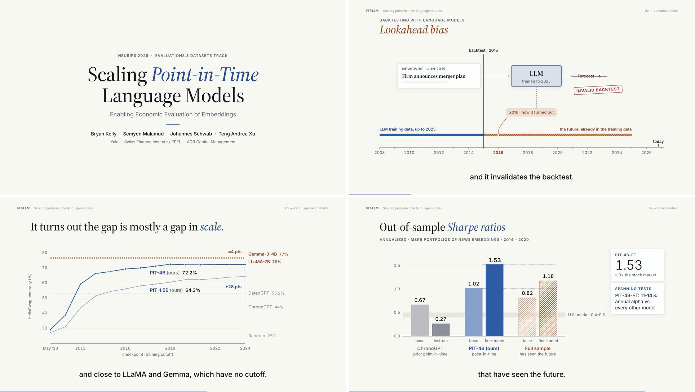
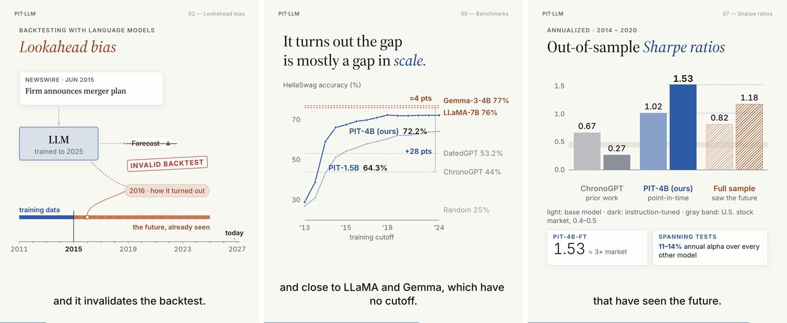

# paper-motion-video

**Turn a research paper into a two-minute explainer video with your coding agent.**

<p align="center">
  <a href="https://cdn.jsdelivr.net/gh/DjoFE2021/paper-motion-video@main/docs/demo.mp4"></a>
</p>
<p align="center"><sub>From the worked example, a two-minute video of <i>Scaling Point-in-Time Language Models</i> (NeurIPS 2026). <a href="https://cdn.jsdelivr.net/gh/DjoFE2021/paper-motion-video@main/docs/demo.mp4">Watch a 50-second extract with sound</a> (MP4, 4 MB).</sub></p>

`paper-motion-video` is an [Agent Skill](https://agentskills.io) for Claude Code and other agents that read `SKILL.md`. Point it at a paper (LaTeX source, PDF, poster or slides) and it produces a narrated video (two minutes by default, or the length you ask for) in a calm, editorial style, in two cuts: 16:9 for YouTube and talks, and 4:5 for phones (LinkedIn, Instagram, X).

- **Charts come from the paper.** They are rebuilt from the paper's own numbers and draw themselves as the voice mentions them.
- **Voice and subtitles are synced.** A neural voice-over comes with word-synced subtitles.
- **Sound stays in the background.** A quiet synthesized score sits under the voice.
- **It runs locally.** No video service and no API keys.

The goal is clarity: get the paper's message across, with every number traceable to the paper.





<sub>Frames from the worked example (`skills/paper-motion-video/examples/pit-llm`), in the 16:9 cut (top) and the 4:5 phone cut (bottom): *Scaling Point-in-Time Language Models*, NeurIPS 2026.</sub>

## What you get

- `out/<name>.mp4`: 1920×1080, 60 fps, voice-over, burned-in subtitles, music, loudness-normalized (−16 LUFS)
- `out/<name>_portrait.mp4`: the phone cut, 1080×1350, same narration with layouts designed for a narrow screen (9:16 and square are available too)
- `out/<name>_share.mp4`: a light 30 fps copy for Slack, email links and social media
- `out/<name>.srt`: the subtitles as a separate file for YouTube, LinkedIn or a conference player
- A project folder you can edit and re-render: the narration is a text file, and each cut's visuals are one JavaScript file

On an 8-core laptop, a 2-minute video narrates in about a minute and renders in about 3–6 minutes per cut. Most of the time goes into the agent writing the story and reviewing frames, which is the part that matters.

## Install

**Claude Code (plugin).** Run these inside Claude Code:

```
/plugin marketplace add DjoFE2021/paper-motion-video
/plugin install paper-motion-video@paper-motion-video
```

From a shell, the same is `claude plugin marketplace add DjoFE2021/paper-motion-video`, then `claude plugin install paper-motion-video@paper-motion-video`. In the Claude desktop app, where `/plugin` does not run, click **+** next to the prompt box, then **Plugins**, **Add marketplace** with `DjoFE2021/paper-motion-video`, then **Add plugin**.

The plugin also brings a **Video progress** pane. While the agent works, it shows a checklist beside the chat (fact sheet, narration, scenes, review, render, package and final check, per cut), a progress bar with the time left while something renders, and a one-line status under the prompt. It opens by itself on a wide terminal; `/video-progress` opens it anytime.

**Claude Code (manual).** Copy the skill folder (this gets the skill alone, without the progress pane):

```bash
git clone https://github.com/DjoFE2021/paper-motion-video
cp -r paper-motion-video/skills/paper-motion-video ~/.claude/skills/
```

On Windows (PowerShell), the second line is `Copy-Item -Recurse paper-motion-video\skills\paper-motion-video $HOME\.claude\skills\`.

**Other agents.** Any agent that supports Agent Skills can use `skills/paper-motion-video/`; it only needs a shell. Or point the agent at `SKILL.md` directly.

The first run installs a private Python environment, the Kokoro voice model and font caches into `~/.cache/paper-motion-video`. This takes 5–10 minutes, depending on your connection, and happens once.

**Requirements:**
- macOS, Linux or Windows
- Python 3.10–3.12, or [uv](https://docs.astral.sh/uv/) (which fetches one)
- internet for the first run
- Google Chrome recommended (otherwise Chromium is downloaded automatically)

## Use

Ask your agent, for example:

> Make a 2-minute video presenting my paper in `~/papers/my-neurips-paper/`. Save it on my Desktop.

> Create a short explainer video of arXiv 2406.01234 for our lab's LinkedIn page. British voice, please.

> Make a 60-second vertical cut of my paper for Instagram Reels, without music.

> From now on, make my paper videos 90 seconds long, portrait only.

The agent then works through these steps:
1. Reads the paper and writes a fact sheet with sources.
2. Drafts a script sized to the length (about 250 words for 2 minutes) and a storyboard, which it shows you if you're around.
3. Synthesizes the voice and designs scenes from the component library.
4. Reviews stills of every scene with an automatic layout audit.
5. Renders and packages the video, then does a final pass through the finished file: an automatic sweep of every quarter second plus a frame-by-frame visual check.

Please listen to the result before sharing it: the agent can see the frames but cannot hear the voice.

### Without an agent

The CLI works on its own:

```bash
SKILL=skills/paper-motion-video
$SKILL/tools/pmv new ~/Desktop/my-video --length 90   # setup flags below; or: --example pit-llm
# edit config.json, script.txt, scenes.js
$SKILL/tools/pmv narrate ~/Desktop/my-video      # voice + timeline + subtitles
$SKILL/tools/pmv review ~/Desktop/my-video       # stills, contact sheets, layout audit
$SKILL/tools/pmv preview ~/Desktop/my-video      # open the printed URL to scrub/play in a browser
$SKILL/tools/pmv all ~/Desktop/my-video --skip-narrate   # music, render, package, final check
$SKILL/tools/pmv check ~/Desktop/my-video                # final pass on its own: file, layout sweep, contact sheets
```

On Windows, run the same commands with `skills\paper-motion-video\tools\pmv.cmd` in cmd or PowerShell (Git Bash runs `tools/pmv` as above).

**Setup options.** `pmv new` takes these flags and prints the word and scene budget for the chosen length:
- `--length`: 90, 2m or 1:30
- `--formats`: landscape, portrait, vertical, square, or a comma list
- `--voice`: a Kokoro voice, such as `bf_emma`
- `--music`: hopeful, reflective, driving or off

`pmv defaults` with the same flags saves them as the starting point for every new project, in `~/.config/paper-motion-video/defaults.json`. Any other `config.json` field can go in that file too, such as your lab's colors. Run `pmv defaults` alone to see the current defaults, or add `--reset` to forget them.

## How it works

```
script.txt ──► Kokoro TTS ──► voice.wav + word timestamps (timeline.json)
                                       │
scenes.js + runtime/ (engine + 34 components) ──► headless Chrome, frame by frame, in parallel ──► video.mp4
                                       │
                       sound cues from the components ──► synthesized score + mix ──► out/*.mp4
```

- **Synced to the narration.** Every animation is a pure function of time, keyed to the spoken words: a bar grows when its number is said. If you re-record the narration, the video re-times itself.
- **A component library.** It covers the usual building blocks of a paper explainer: title and end cards, kinetic typography, bar/line charts, tables, timelines, flow diagrams, filters and progress strips, plus a layout auditor that catches overlapping text and text spilling out of its card, both before rendering and in a final pass over the finished video.
- **An editorial design system, readable on phones.** Paper-white, serif headlines, one accent color for "ours", flat charts with direct labels, no glows, gradients or neon, and a type scale with a minimum size the audit enforces. See [`references/design.md`](skills/paper-motion-video/references/design.md).

## Repository layout

```
.claude-plugin/              plugin + marketplace manifests
hooks/  types/  tests/       the Claude Code progress pane (a hooks module), its state contract and its tests
skills/paper-motion-video/
  SKILL.md                   the agent's instructions
  references/                storytelling, design rules, component API, troubleshooting
  runtime/                   engine.js, components.js, theme.css, page template
  tools/                     pmv CLI (pmv for bash, pmv.cmd for Windows): new, defaults, narrate, review, music, video, final, check
  templates/project/         starter project
  examples/pit-llm/          complete 2-minute example (script + scenes)
docs/                        README images, the demo loop and extract, the social-preview card
```

## Limitations

- English narration.
- The voice is synthetic. Kokoro is good but not a human narrator, so check pronunciations.
- The music is generated, not composed; you can turn it off in `config.json`.
- Rendering fetches fonts once from Google Fonts and cdnjs, then works offline.

## Credits and licenses

This project is MIT licensed (see `LICENSE`). It downloads and uses these at runtime:
- [Kokoro-82M](https://huggingface.co/hexgrad/Kokoro-82M) (Apache-2.0) for the voice
- [KaTeX](https://katex.org) (MIT) for equations
- [qrcode-generator](https://github.com/kazuhikoarase/qrcode-generator) (MIT) for QR codes
- [Source Serif 4](https://fonts.google.com/specimen/Source+Serif+4), [Inter](https://fonts.google.com/specimen/Inter) and [IBM Plex Mono](https://fonts.google.com/specimen/IBM+Plex+Mono) (SIL OFL)
- [Playwright](https://playwright.dev) (Apache-2.0)
- ffmpeg via [imageio-ffmpeg](https://github.com/imageio/imageio-ffmpeg)

The example video presents *Scaling Point-in-Time Language Models: Enabling Economic Evaluation of Embeddings* by Bryan Kelly, Semyon Malamud, Johannes Schwab and Teng Andrea Xu (NeurIPS 2026).
